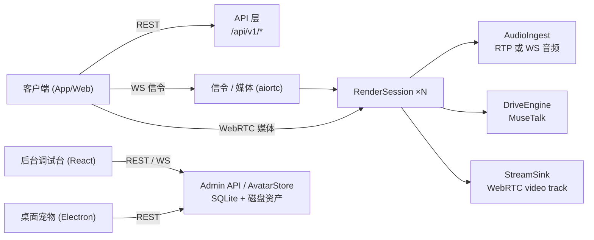

# 数字人服务 (Digital Human Service)

实时交互数字人服务：接收**音频 + 形象 ID**，输出**实时数字人视频流**（WebRTC）。
附带 React 后台管理台（形象管理 / 会话调试 / 数字人对话 / 系统监控）。

支持**三种并存**的数字人形态，由形象所属的**数字人模型**（`avatars.drive_model`）区分：

| 模型 | 渲染位置 | 驱动方式 |
|---|---|---|
| `musetalk` | 服务端（GPU） | MuseTalk 1.5，WebRTC 视频流 |
| `wav2lip` | 服务端（CPU 即可，有 GPU 更快） | Wav2Lip，36.3 M 参数 / 526 MB 权重，WebRTC 视频流 |
| `live2d` | 客户端（WebGL） | Cubism SDK；服务端只托管模型文件，**不产出任何像素** |

Live2D 的口型在客户端由**正在播放的那个 AudioBuffer** 离线预算出的包络驱动，因此嘴与声音
天然零漂移。管理台的三个页面都能选择 Live2D 形象；另有 Electron 桌面宠物（透明置顶窗口）。

生产路径是**真实 MuseTalk 1.5**：上传一张照片，服务端跑人脸检测 → 对齐裁剪 → 解析遮罩 →
VAE 编码，产出一份形象包；会话中每个 100ms 音频块驱动一次 UNet，解出下半脸再融合回原图。

技术栈：Python 3.11+ / FastAPI / aiortc / SQLAlchemy + SQLite；React + Vite + TS + vitest。

## 工程结构

仓库里有**三个独立工程**，互相之间只有 HTTP API 调用，不共享源码：

```
digital-human/
├── dh-server/      服务端（Python）—— 含 dh_server/ 包、tests/、run.py、scripts/、vendor/
├── dh-admin-ui/    管理台（React + Vite）—— 构建产物由服务端挂在 /admin
├── dh-pet/         桌面宠物（Electron + React + Vite）—— 独立应用
├── data/           运行时数据（形象包、权重、SQLite）+ Cubism SDK
└── docs/
```

- **dh-server**：FastAPI 服务、数字人引擎与模型注册表、SQLite 与形象资产。
- **dh-admin-ui**：管理台 SPA。开发时 Vite 把 `/api` 代理到 `127.0.0.1:8000`；
  生产时构建产物由服务端挂载在 `/admin`。
- **dh-pet**：桌面宠物。透明置顶窗口，自带一份 Live2D 渲染层，**渲染在本地，
  服务端只托管模型文件**。

三个工程各自 `npm install` / `pip install`，互不依赖对方的源码。唯一的共享目录是
`data/`：Cubism SDK 的 Framework 源码要进两个前端的打包产物，属于第三方资源，不是代码耦合。

## 架构



- **API 层**：形象 CRUD、会话生命周期、API Key 鉴权（`/api/v1/*`）。
- **SessionManager / RenderSession**：会话编排与状态机（`idle → listening → speaking → closed`）。
  空闲时按帧率推静态保活帧，避免视频轨因无帧可发而冻住。
- **DriveEngine**：口型驱动抽象，`drive(avatar_pack, audio_chunk) -> frames`；实现 `musetalk`
  （GPU）与 `wav2lip`（CPU 即可，有 GPU 更快）。真引擎把同步重活放到单工作线程池，事件循环不被阻塞。
- **AvatarPipeline**：上传照片/视频 → 形象包的抽象；实现 `musetalk`（真实制作）
  与 `wav2lip`（检测人脸 + 烘焙闭嘴空闲轨）。
- **数字人模型注册表**（`dh-server/dh_server/model_registry.py`）：一个模型 = 一条流水线 + 一个引擎，
  成对注册。当前有 MuseTalk（服务端驱动）、Wav2Lip（服务端驱动，纯 CPU 即可）
  与 Live2D（客户端渲染，没有引擎）；新增模型 = 实现两个抽象基类 + 注册一条。
- **AvatarStore**：形象包管理（SQLite 元数据 + 磁盘资产）。
- **音频双通道**：RTP audio track 为主，WS 音频分片为备，进入同一 `AudioIngest`，引擎无感知。
- **会话短生命周期**：显式 DELETE 或 `DH_SESSION_IDLE_TIMEOUT` 秒无音频自动回收。

## 快速开始

前置：Python 3.11+、Node 18+。跑 MuseTalk 另需 NVIDIA GPU（见下节）；
`wav2lip` 引擎**纯 CPU 即可**（见「Wav2Lip 引擎」）。

服务端注册了 MuseTalk / Wav2Lip / Live2D 三个数字人模型。
下面第一个 `.venv` 只用于跑单测。

```bash
# 1. 单测用的虚拟环境（torch-free，够跑全部单测）
python -m venv .venv
source .venv/Scripts/activate          # Windows (Git Bash)；PowerShell 用 .venv\Scripts\Activate.ps1
pip install -e "dh-server/[dev]"

# 2. 构建后台调试台（构建产物由 FastAPI 挂载到 /admin）
cd dh-admin-ui
npm install
npm run build
cd ..

# 3. 配置环境变量
cp .env.example .env                    # 按需修改 DH_LIVE2D_SDK_DIR / DH_V1_API_TOKEN
```

要跑真实模型，先按「[MuseTalk 环境准备](#musetalk-环境准备)」建好 `.venv-musetalk`
并拉取权重，然后用那个解释器启动：

```bash
./dh-server/scripts/setup_musetalk.sh             # 建 .venv-musetalk 并装依赖
./dh-server/scripts/fetch_musetalk_weights.sh     # 拉权重（约数 GB）
source .venv-musetalk/Scripts/activate  # PowerShell 用 .venv-musetalk\Scripts\Activate.ps1
python dh-server/run.py                 # 启动后端
```

要用 `wav2lip` 引擎，再拉它自己的源码与权重（526 MB）：

```bash
./dh-server/scripts/setup_wav2lip.sh              # checkout vendor/Wav2Lip（锁 commit）+ 拉权重
```

`dh-server/run.py` 是后端的启动入口，等价于
`python -m uvicorn --factory dh_server.main:create_app --host 0.0.0.0 --port 8000`，
另外做了三件事：把工作目录钉在仓库根目录（`.env` / `data/` / `dh-admin-ui/dist`
才不会指错地方）、在任何目录下都能 import 到 `dh_server`、在端口被占用**之前**
先报出这台机器缺什么（没有 torch、没有 CUDA、MuseTalk 权重不全、管理台没构建）。


启动参数：`--host` / `--port` / `--reload`（只监听 `dh_server/` 的改动，开发用）/
`--log-level`。**用哪个解释器跑 `run.py`，后端就跑在哪个解释器上** —— 想跑真实
MuseTalk 就先激活 `.venv-musetalk`。

打开 <http://127.0.0.1:8000/admin> 进入管理台（无登录步骤，见「关于鉴权」）。

健康检查：

```bash
curl http://127.0.0.1:8000/healthz
# {"status":"ok","gpu":true,"models":[{"name":"musetalk","label_zh":"MuseTalk 1.5","loaded":true,"client_rendered":false},{"name":"wav2lip","label_zh":"Wav2Lip","loaded":false,"client_rendered":false},{"name":"live2d","label_zh":"Live2D","loaded":false,"client_rendered":true}]}
```

`gpu` 在启动时探测一次（导入 torch 是昂贵的那一步，而结论不会在运行中改变）。
`models` 列出**全部注册的数字人模型**及各自的驻留状态 —— 多个模型可以同时驻留，
不需要「切到某个模型」这一步。

单测：`cd dh-server && pytest`（或 `python -m pytest`）。
管理台开发模式：`cd dh-admin-ui && npm run dev`（Vite 已把 `/api` 代理到 `127.0.0.1:8000`）。

## 桌面宠物（Live2D）

桌宠是**独立工程** `dh-pet/`：Electron 应用，透明置顶窗口 + 鼠标穿透 + 托盘，
自带一份 Live2D 渲染层（与管理台那份各管各的，不共享源码），**渲染在本地，
服务端只托管模型文件**。

```bash
# 1. 先把后端跑起来（桌宠连的是它）
cd E:/project/digital-human
.venv/Scripts/python.exe dh-server/run.py

# 2. 再起桌宠
cd dh-pet
npm install
npm start          # = npm run build && electron .
```

`npm start` 会先打包再启动（打包用相对路径，file:// 下才认得 assets），
所以**改了前端代码要重跑一次**。桌宠默认连 `http://127.0.0.1:8000`。

**托盘菜单**：显示 / 隐藏宠物、服务地址、打开配置文件、查看服务端状态、退出。
服务地址与令牌改在配置文件里（托盘的「打开配置文件…」就是打开它）：
`%APPDATA%\dh-pet\pet.json`，形如

```json
{ "serverUrl": "http://127.0.0.1:8000", "token": "" }
```

（桌宠以前是管理台里的一个路由，配置落在 `%APPDATA%\admin-ui\pet.json`；
新配置不存在时会自动把旧的那份搬过来。）

服务端配了 `DH_V1_API_TOKEN` 时，桌宠也要带同一个令牌，否则模型请求 401，窗口里
是空的。令牌留空 = 不校验（本地开发不用配）。

**透明背景**：窗口是透明的，页面底色（`html` / `body` / `#root`）也是透明的，
所以桌宠直接浮在桌面上，底下就是你的壁纸。输入框和错误提示保留面板底色。

**鼠标穿透的代价**：窗口默认不吃鼠标事件（免得挡住下面的程序）。光标移到窗口上时
穿透自动关掉，移开再打开 —— 所以**输入框要先把光标移上去才能点**。眼球跟随光标不
受影响：主进程在轮询光标位置（窗口穿透时收不到 move 事件）。


## Wav2Lip 引擎（wav2lip）

MuseTalk 是 GPU 专属的：它的 UNet 是 fp16 的，CPU 上跑不了。`wav2lip` 是第二个
服务端驱动的模型，换来的是**纯 CPU 也能实时**：

| | MuseTalk 1.5 | Wav2Lip |
|---|---|---|
| 参数量 | 947 M | **36.3 M**（一个生成器） |
| 权重 | ~4 GB | **526 MB**（生成器 436 MB + S3FD 检测器 90 MB） |
| 硬件 | 8–12 GB 显存 | **纯 CPU 即可**（实测中位 79 ms / 100 ms 音频块）；有 GPU 时约 21 ms |
| 形象制作 | 上传一张照片 | 上传一段**人脸清晰的口播视频**（或一张照片） |

Wav2Lip 是**通用**模型：一份权重驱动所有形象，不需要按人训练，所以制作流程比
MuseTalk 简单得多：

1. 上传这个人的口播视频（单人正脸、不遮挡）；照片也行，此时形象只有一张脸，
   只有嘴在动。
2. 后台任务逐帧检测人脸（S3FD，与上游同一套裁剪几何），把画面与人脸框写进
   形象包，并用**静音 mel 窗口**把同一批帧重绘一遍作为**闭嘴空闲轨**。
3. 产出形象包后，服务端实时驱动它。

空闲轨（`wav2lip/idle_frames/`）是必需的：源素材是一段说话视频，直接回放会让
角色在会话没说话时也在演说话；重绘一遍之后动作不变、嘴闭着，运行时只是多解
一个 JPEG。

**口型与声音的同步**：上游的 mel 窗口是 200 ms，且从当前帧开始向后取（含 200 ms
「未来」音频）。实时流里未来音频还没到，所以窗口里还没到的那部分填**静音**
（上游在音频结尾也是这么补的）——画面因此永远不落后于声音。实测这样渲染出来的
脸与完整窗口的差异约 0.5%（逐像素平均），嘴形一致。

详细设计见
[docs/superpowers/specs/2026-10-26-wav2lip-engine-design.md](docs/superpowers/specs/2026-10-26-wav2lip-engine-design.md)。

```bash
./dh-server/scripts/setup_wav2lip.sh       # checkout vendor/Wav2Lip（锁 commit）+ 拉 526 MB 权重
```

一台纯 CPU 的机器只需要：

```bash
pip install torch --index-url https://download.pytorch.org/whl/cpu
pip install -e ".[wav2lip]"
```

## 环境变量

所有配置经 `DH_` 前缀读取，也可写入 `.env`（`.env` 已 gitignore，**切勿提交**）。

| 变量 | 默认值 | 说明 |
|---|---|---|
| `DH_AVATAR_MAX_VIDEO_SECONDS` | `15.0` | 驱动视频时长上限（秒），超出上传即 422 |
| `DH_AVATAR_MAX_VIDEO_FRAMES` | `375` | 驱动视频解码帧数上限（15s × 25fps） |
| `DH_AVATAR_CACHE_SIZE` | `2` | 引擎按形象缓存的份数；视频形象每份常驻约 1GB 内存 |
| `DH_AVATAR_MAX_UPLOAD_BYTES` | `300000000` | 上传字节上限，超出返回 413 |
| `DH_DATA_DIR` | `data` | 运行时数据目录（SQLite、形象资产、模型权重） |
| `DH_DATABASE_URL` | `sqlite:///data/digital-human.db` | SQLAlchemy 数据库 URL |
| `DH_V1_API_TOKEN` | 空 | Live2D 模型托管端点的可选令牌（请求头 `X-V1-Token`）。留空 = 不校验，供桌面宠物连远程部署 |
| `DH_LIVE2D_ENABLED` | `true` | **仅上报，不生效** —— 该值只出现在 Live2D 健康检查的 JSON 里（管理台系统页据此显示「启用：否」），服务端没有任何端点按它分支。设为 `false` **不会**关掉 Live2D 功能：上传端点与创建形象页的 Live2D 选项照常可用 |
| `DH_LIVE2D_SDK_DIR` | `data/CubismSdkForWeb-5-r.5` | Cubism SDK 所在目录。服务端**只**从这里读 `Core/`（core）与 `Framework/Shaders/`（GLSL）下发给浏览器，不渲染任何 Live2D |
| `DH_LIVE2D_MAX_ARCHIVE_ENTRIES` | `512` | 上传的 Live2D 压缩包条目数上限。zip 是外部输入，一个几百 KB 的包可以声明上百万个条目 |
| `DH_LIVE2D_MAX_UNPACKED_BYTES` | `512000000` | 同一个压缩包**解压后**的累计字节上限。压缩包体积上限挡不住高压缩比炸弹（几 KB 展开成几百 MB 全零） |
| `DH_LIVE2D_MAX_ENTRY_BYTES` | `64000000` | 单个文件解压后的字节上限 |
| `DH_SESSION_IDLE_TIMEOUT` | `60` | 会话无音频自动回收秒数 |
| `DH_SESSION_SWEEP_INTERVAL` | `10` | 空闲回收扫描周期（秒） |
| `DH_FRAME_WIDTH` | `720` | 输出视频宽 |
| `DH_FRAME_HEIGHT` | `1280` | 输出视频高 |
| `DH_FPS` | `25` | 输出帧率 |
| `DH_VIDEO_BITRATE` | `3500000` | 出站 H.264 目标码率（bps）。aiortc 的 OpenH264 默认只有 1 Mbps，而 720×1280@25 下嘴部是画面里最耗码率的区域，1 Mbps 会糊成马赛克 |
| `DH_VIDEO_MAX_BITRATE` | `4000000` | 出站 H.264 码率上限（bps），配合 aiortc 的 REMB 上限使用 |
| `DH_SAMPLE_RATE` | `48000` | 音频采样率（Hz） |

> **TTS 与 LLM 配置都不走环境变量**。MiniMax TTS 的 `api_key` / `group_id` /
> `base_url` / `model` / `sample_rate`，以及 OpenAI 兼容大模型的 `api_key` /
> `base_url` / `model`，都在 Models 页面的「服务」列表中点对应行的 **[设置]**
> 写入 SQLite `settings` 表；`.env` 里没有对应变量。这样能让一次部署的服务在 UI
> 上切换 provider，也避免泄漏的 `DH_MINIMAX_*` / `DH_LLM_*` 在没显式 opt-in 时
> 打开合成或 chat 端点。
>
> **数字人模型的选择同样不走环境变量**，而且现在**没有「选择」这一步**。
> 每个**形象**记录自己的模型（`avatars.drive_model`），服务端按这个模型取引擎；
> 多个模型可以同时驻留，在 Models 页逐个加载 / 卸载。
>
> 从旧版本（`.env` 里带 `DH_MINIMAX_*`）升级的机器可以跑一次迁移脚本把现有值
> 搬进 `settings` 表：`python scripts/migrate_minimax_env_to_db.py`。

> **已移除的变量**：`DH_ADMIN_PASSWORD`、`DH_ADMIN_TOKEN`（登录鉴权随多租户重构删除）、
> `DH_MINIMAX_*`（改由 Models 页配置）与 `DH_DRIVE_ENGINE` / `DH_AVATAR_PIPELINE`
> （改由每个形象自带模型）都已不再是 `Settings` 字段。旧 `.env` 里留着
> 它们不会报错 —— 服务端对未知 `DH_*` 变量一律忽略 —— 但也不会有任何作用，可以直接删掉。

## 对外 API

媒体参数：音频 48kHz / 16bit / 单声道 PCM；视频 25fps，720×1280，H.264（WebRTC video track）。

### 业务面 `/api/v1`（**无鉴权**）

| 方法 | 路径 | 说明 |
|---|---|---|
| POST | `/api/v1/avatars` | multipart `name` + `file` 上传照片或短视频（≤15s）创建形象，返回 `{avatar_id, status:"pending"}`，异步预处理。视频形象以动态驱动方式渲染：头部/身体沿用视频运动，嘴部由音频驱动；空闲时循环播放源视频画面，录制时请保持闭嘴、不说话 |
| GET | `/api/v1/avatars` | 形象列表。可选 `?drive_model=live2d` 只列 Live2D 形象 |
| GET | `/api/v1/live2d/avatars/{id}/model/{path}` | 模型目录内的单个文件。`DH_V1_API_TOKEN` 非空时需 `X-V1-Token` |
| GET | `/api/v1/live2d/runtime/{path}` | Cubism SDK 的 `Core/` 与 `Shaders/`。URL 命名空间固定，服务端负责把 `Shaders/` 映射到 SDK 里的 `Framework/Shaders/`（5-r.5 的 GLSL 不与 `Core/` 并列）。**不鉴权**：core 经 `<script>` 标签加载（无法带请求头），shader 由 framework 自行 fetch（同样无法配置请求头）。路径限定在这两棵子树内，`..` 无法越界 |
| GET | `/api/v1/avatars/{avatar_id}` | 形象详情（`status` 供轮询制作完成：`pending`/`processing`/`ready`/`failed`） |
| DELETE | `/api/v1/avatars/{avatar_id}` | 删除形象及资产（204） |
| POST | `/api/v1/sessions` | JSON `{"avatar_id"}` 创建会话，返回 `{session_id, status, signal_url, audio_url}`（形象须为 `ready`） |
| GET | `/api/v1/sessions` | 会话列表 |
| GET | `/api/v1/sessions/{session_id}` | 会话详情（含实时 `metrics`，见下） |
| DELETE | `/api/v1/sessions/{session_id}` | 结束会话并落库最终指标（204） |
| WS | `/api/v1/ws/signal/{session_id}?api_key=` | WebRTC 信令（SDP offer/answer、ICE） |
| WS | `/api/v1/ws/audio/{session_id}?api_key=` | 备用驱动通道：二进制帧为 s16le 单声道 48kHz PCM；文本帧 `{"type":"flush"}` 排空残留分块 |

> 健康检查 `GET /healthz`（无需鉴权）。

#### 会话指标 `metrics`

| 字段 | 含义 |
|---|---|
| `frames_out` | 被音频**驱动**产生的帧数 |
| `keepalive_frames` | 空闲保活帧数。与 `frames_out` 分开计：它没有驱动任何东西，混进去会让一个长期空转的会话看起来跑得更好 |
| `dropped_frames` | 下游 sink 已关闭后仍尝试推送的帧数 |
| `fps` | 名义帧率（配置值，非实测） |
| `avg_latency_ms` | 每块延迟的 EMA（0.8 旧 + 0.2 新） |
| `blocks` | 累计处理的音频块数（每块 100ms） |
| `state` | `idle` / `listening` / `speaking` / `closed` / `error` |
| `queue_depth` | 引擎工作队列中待处理的作业数（同步渲染的引擎恒为 0） |
| `overflows` | WebRTC 视频轨因队列满而丢弃的帧数。持续 > 0 表示渲染跟不上推流 |
| `p50_latency_ms` / `p95_latency_ms` / `max_latency_ms` | 最近 600 块（60 秒）延迟分位数，无样本时为 `0.0` |
| `latency_histogram` | 同一窗口的延迟分桶（`<25` … `>=250` ms），零桶省略 |

**块延迟是唯一值得盯的实时性指标**：一个块承载 100ms 音频，所以延迟长期超过 100ms 就意味着
音频入流速度超过渲染速度、A/V 延迟无界增长。此时先看 `overflows` 与 `queue_depth` 是否同步上升。

#### 调试页文本驱动（MiniMax TTS）

调试页除了麦克风与上传音频文件，还可以**只输入文本**：页面向 `POST /api/admin/tts`
要一段合成音频，拿到后走与上传文件**完全相同**的那条通道（`sendAudioBlob` →
`decodeAudioData` → 重采样到 48k → WS 音频分片）。

链路里有两处值得知道：

- **采样率对不上是常态。** MiniMax 最高只到 44100 Hz，而渲染会话固定吃 48000 Hz。
  所以服务端只把 hex 音频套上 WAV 头原样返回，**重采样放在浏览器**——复用上传路径里
  已经测过的那段代码，服务端因此不需要任何音频编解码依赖。
- **WebRTC 只回传视频轨，没有音频。** 调试页会另外用 `<audio>` 本地回放同一段合成音频，
  否则你只能看见嘴动、听不见声音。

需要在 Models 页面「服务」列表的 MiniMax TTS 行点 **[设置]** 填 API Key；未配置时
按钮会报出服务端那句 503 的说明。

### 管理面 `/api/admin`（**无鉴权**）

| 方法 | 路径 | 说明 |
|---|---|---|
| POST | `/api/admin/login` | JSON `{"password"}` → `{"token"}`。**已失效**，登录鉴权随多租户重构删除，保留仅为不打断旧调用 |
| POST | `/api/admin/live2d/avatars` | **已移除** —— Live2D 现在是一个数字人模型，上传走统一的 `POST /api/admin/avatars`（带 `model=live2d`） |
| DELETE | `/api/admin/live2d/avatars/{id}` | **已移除** —— 删除走统一的 `DELETE /api/admin/avatars/{id}` |
| GET | `/api/admin/live2d/health` | SDK 是否就绪。**从不抛错** —— SDK 缺失是要在系统页展示的状态，不是异常 |
| GET | `/api/admin/avatars/{id}/live2d/model` | 该模型自己声明的表情清单与动作分组（从工程目录读，不从 `config_json` 读）。表情映射是按**模型表情列表里的位置**写的，所以控制台要靠这个端点给出可选项 |
| PATCH | `/api/admin/avatars/{id}/live2d` | 改 Live2D 形象的表情映射（`{"expressions": {"smile": 4}}`，可选 `entry`）。落库前用工程目录重新校验：模型没有的下标当场 422，且不影响已存的映射 |
| GET | `/api/admin/system` | 各运行时状态（`runtimes`）/ GPU / 版本 / 数据目录 |
| GET | `/api/admin/models` | Models 页的轮询载荷：每个数字人模型一行（外加形象动画器）、服务行、GPU 快照 |
| GET | `/api/admin/drive-models` | 已注册的数字人模型清单：`name` / `label_zh` / `source_kind` / `client_rendered` / `max_video_seconds`（该模型的源素材时长上限，覆盖全局设置时才有值）。形象创建表单与选择器共用 |
| POST | `/api/admin/models/{model}/load` / `unload` | 按**模型名**加载 / 卸载该模型的权重。`animator:<name>` 行仍走各自的派发 |
| GET | `/api/admin/tenants` | 租户列表 |
| POST | `/api/admin/tenants` | JSON `{"name"}` → `{tenant_id, name, api_key}`（`api_key` 仅此一次返回） |
| POST | `/api/admin/tenants/{tenant_id}/api-key` | 轮换并返回新 API Key（旧 key 立即失效） |
| GET | `/api/admin/avatars` | 形象列表（可选 `?drive_model=` 过滤） |
| POST | `/api/admin/avatars` | multipart `name` + `model`（数字人模型名）+ `file` 创建形象。`model=live2d` 时 `file` 是整个 Cubism 工程的 zip，另可带 `entry`(可选) 与 `expressions`(可选 JSON)；`entry` 留空则自动探测 `*.model3.json`（工程压缩在子目录里也能找到），校验失败 422 且不留行、不留文件。`model=wav2lip` 时 `file` 是一段人脸清晰的口播视频（或一张照片），构建时逐帧检测人脸并烘焙闭嘴空闲轨 |
| GET | `/api/admin/avatars/{avatar_id}` | 形象详情 |
| DELETE | `/api/admin/avatars/{avatar_id}` | 删除形象（204） |
| POST | `/api/admin/avatars/{avatar_id}/retry` | 重试制作（202） |
| PATCH | `/api/admin/avatars/{avatar_id}/config` | 调优 `mouth_scale` / `expression_intensity` |
| GET | `/api/admin/avatars/{avatar_id}/idle.mp4` | 空闲循环视频（视频形象；首次请求时生成，支持 Range） |
| GET | `/api/admin/avatars/{avatar_id}/normalized.png` | 静态画面（照片形象与回退） |
| POST | `/api/admin/tts` | JSON `{"text", "voice_id"}` → `audio/wav`。调试页用；`text` 为空 400，`voice_id` 缺失 400，未配置 API Key 503，MiniMax 报错 502 |
| GET | `/api/admin/tts/config` | MiniMax TTS 配置；返回 `api_key_masked`（`****<末4位>`，未配置时为 `(未设置)`） |
| PUT | `/api/admin/tts/config` | 同上，写入到 `settings` 表；保存后下一次合成请求即刻生效 |
| GET | `/api/admin/llm/config` | 大模型（OpenAI 兼容）配置；返回 `api_key_masked` 与 `configured` 标志 |
| PUT | `/api/admin/llm/config` | 同上，写入到 `settings` 表 |
| POST | `/api/admin/llm/chat` | JSON `{messages}` → `{content}`。非流式；用作同步回退 |
| POST | `/api/admin/llm/chat/stream` | JSON `{messages}` → `text/event-stream`。每帧 `{"delta": "..."}` / `{"done": true}` / `{"error": ...}`。调试页大模型对话的入口 |
| GET | `/api/admin/jobs` | 制作任务（AvatarJob）列表 |
| GET | `/api/admin/sessions` | 会话列表（含实时指标） |
| POST | `/api/admin/sessions/sweep` | 手动触发空闲会话回收 |
