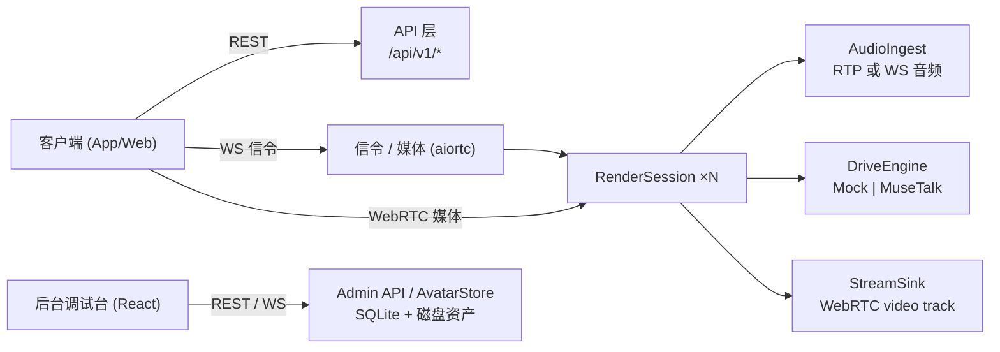

# 数字人服务 (Digital Human Service)

商用实时交互数字人服务：接收**音频 + 形象 ID**，输出**实时数字人视频流**（WebRTC）。
服务边界只做「音频驱动 + 渲染 + 视频流输出」，LLM/ASR 由调用方自建；引擎层可插拔，
开发环境用 Mock 引擎即可无 GPU 跑通全链路。附带 React 后台调试台（形象制作 / 会话调试 / 系统监控）。

技术栈：Python 3.11+ / FastAPI / aiortc / SQLAlchemy + SQLite；React + Vite + TS。

## 架构



- **API 层**：形象 CRUD、会话生命周期、API Key 鉴权（`/api/v1/*`）。
- **SessionManager / RenderSession**：会话编排与状态机（`idle → listening → speaking → closed`）。
- **DriveEngine**：口型驱动抽象，`drive(avatar_pack, audio_chunk) -> frames`；实现 `mock` / `musetalk`。
- **AvatarStore**：形象包管理（SQLite 元数据 + 磁盘资产）。
- **音频双通道**：RTP audio track 为主，WS 音频分片为备，进入同一 `AudioIngest`，引擎无感知。
- **会话短生命周期**：显式 DELETE 或 `DH_SESSION_IDLE_TIMEOUT` 秒无音频自动回收。

## 快速开始

前置：Python 3.11+、Node 18+。

```bash
# 1. Python 虚拟环境与依赖
python -m venv .venv
source .venv/Scripts/activate          # Windows (Git Bash)；PowerShell 用 .venv\Scripts\Activate.ps1
pip install -e ".[dev]"

# 2. 构建后台调试台（构建产物由 FastAPI 挂载到 /admin）
cd admin-ui
npm install
npm run build
cd ..

# 3. 配置环境变量
cp .env.example .env                    # 按需修改 DH_ADMIN_PASSWORD / DH_ADMIN_TOKEN

# 4. 启动服务
python -m uvicorn --factory server.main:create_app --host 0.0.0.0 --port 8000
```

打开 <http://127.0.0.1:8000/admin>，用 `.env` 中的 `DH_ADMIN_PASSWORD` 登录调试台。

> **必须使用 `--factory` 形式**：`server/main.py` 只暴露 `create_app()` 工厂，没有模块级 `app`，
> 因此 `uvicorn server.main:app` 会失败。`uvicorn --factory server.main:create_app` 等价可用。

健康检查：

```bash
curl http://127.0.0.1:8000/healthz
# {"status":"ok","engine":"mock","gpu":false}
```

开发时前端可 `cd admin-ui && npm run dev`（Vite 已把 `/api` 代理到 `127.0.0.1:8000`）。

## 环境变量

所有配置经 `DH_` 前缀读取，也可写入 `.env`（`.env` 已 gitignore，**切勿提交**）。

| 变量 | 默认值 | 说明 |
|---|---|---|
| `DH_DRIVE_ENGINE` | `mock` | 驱动引擎：`mock` 或 `musetalk` |
| `DH_DATA_DIR` | `data` | 运行时数据目录（SQLite、形象资产、模型权重） |
| `DH_DATABASE_URL` | `sqlite:///data/digital-human.db` | SQLAlchemy 数据库 URL |
| `DH_ADMIN_PASSWORD` | `admin123` | 后台调试台登录密码 |
| `DH_ADMIN_TOKEN` | `dev-admin-token` | 管理面 `X-Admin-Token` 校验令牌 |
| `DH_SESSION_IDLE_TIMEOUT` | `60` | 会话无音频自动回收秒数 |
| `DH_SESSION_SWEEP_INTERVAL` | `10` | 空闲回收扫描周期（秒） |
| `DH_FRAME_WIDTH` | `720` | 输出视频宽 |
| `DH_FRAME_HEIGHT` | `1280` | 输出视频高 |
| `DH_FPS` | `25` | 输出帧率 |
| `DH_SAMPLE_RATE` | `48000` | 音频采样率（Hz） |

## 对外 API

媒体参数：音频 48kHz / 16bit / 单声道 PCM；视频 25fps，720×1280，H.264（WebRTC video track）。

### 业务面 `/api/v1`（鉴权：`X-API-Key` 请求头）

| 方法 | 路径 | 说明 |
|---|---|---|
| POST | `/api/v1/avatars` | multipart `name` + `file` 上传照片创建形象，返回 `{avatar_id, status:"pending"}`，异步预处理 |
| GET | `/api/v1/avatars` | 形象列表 |
| GET | `/api/v1/avatars/{avatar_id}` | 形象详情（`status` 供轮询制作完成：`pending`/`processing`/`ready`/`failed`） |
| DELETE | `/api/v1/avatars/{avatar_id}` | 删除形象及资产（204） |
| POST | `/api/v1/sessions` | JSON `{"avatar_id"}` 创建会话，返回 `{session_id, status, signal_url, audio_url}`（形象须为 `ready`） |
| GET | `/api/v1/sessions` | 会话列表 |
| GET | `/api/v1/sessions/{session_id}` | 会话详情（含 `metrics`：`frames_out` / `dropped_frames` / `fps` / `avg_latency_ms`） |
| DELETE | `/api/v1/sessions/{session_id}` | 结束会话并落库最终指标（204） |
| WS | `/api/v1/ws/signal/{session_id}?api_key=` | WebRTC 信令（SDP offer/answer、ICE） |
| WS | `/api/v1/ws/audio/{session_id}?api_key=` | 备用驱动通道：二进制帧为 s16le 单声道 48kHz PCM；文本帧 `{"type":"flush"}` 排空残留分块 |

> 健康检查 `GET /healthz`（无需鉴权）。

### 管理面 `/api/admin`（除 `login` 外鉴权：`X-Admin-Token` 请求头）

| 方法 | 路径 | 说明 |
|---|---|---|
| POST | `/api/admin/login` | JSON `{"password"}` → `{"token"}`（登录入口，不在鉴权之后） |
| GET | `/api/admin/system` | 引擎 / GPU / 版本 / 数据目录 |
| GET | `/api/admin/tenants` | 租户列表 |
| POST | `/api/admin/tenants` | JSON `{"name"}` → `{tenant_id, name, api_key}`（`api_key` 仅此一次返回） |
| POST | `/api/admin/tenants/{tenant_id}/api-key` | 轮换并返回新 API Key（旧 key 立即失效） |
| GET | `/api/admin/avatars` | 形象列表（可选 `?tenant_id=` 过滤） |
| POST | `/api/admin/avatars` | multipart `name` + `file`（可选 `tenant_id`）创建形象 |
| GET | `/api/admin/avatars/{avatar_id}` | 形象详情 |
| DELETE | `/api/admin/avatars/{avatar_id}` | 删除形象（204） |
| POST | `/api/admin/avatars/{avatar_id}/retry` | 重试制作（202） |
| PATCH | `/api/admin/avatars/{avatar_id}/config` | 调优 `mouth_scale` / `expression_intensity` |
| GET | `/api/admin/avatars/{avatar_id}/preview.png` | 静态预览（可选 `?level=0..1` 驱动口型） |
| GET | `/api/admin/jobs` | 制作任务（AvatarJob）列表 |
| GET | `/api/admin/sessions` | 会话列表（含实时指标） |
| POST | `/api/admin/sessions/sweep` | 手动触发空闲会话回收 |

## MuseTalk 权重准备

开发/测试用 `DH_DRIVE_ENGINE=mock` 即可，无需权重。启用真实引擎：

1. 下载 MuseTalk 权重，放到 `$DH_DATA_DIR/models/musetalk/`（默认 `data/models/musetalk/`）。
2. 该目录须包含以下清单（`prepare()` 会逐一检查，缺失即抛 `EngineUnavailable`）：
   - `musetalk.json`
   - `musetalk_v2.ckpt`
   - `vae.pth`
   - `whisper/`（Whisper 音频编码器目录）
3. 设置 `DH_DRIVE_ENGINE=musetalk` 后重启服务；GPU 可用时自动使用 CUDA。

```
data/models/musetalk/
├─ musetalk.json
├─ musetalk_v2.ckpt
├─ vae.pth
└─ whisper/
```

## 目录结构

```
digital-human/
├─ server/                  # Python 包
│  ├─ main.py               # FastAPI app 工厂 create_app()
│  ├─ config.py             # DH_* 配置
│  ├─ api/                  # REST + WS：avatars, sessions, admin, deps
│  ├─ core/                 # session_manager, render_session, audio_ingest, stream_sink, webrtc
│  ├─ engine/               # base(接口), mock_engine, musetalk_engine
│  ├─ avatar/               # store, pipeline
│  └─ db/                   # models, session
├─ admin-ui/                # React + Vite 调试台（构建产物挂载到 /admin）
├─ data/                    # 运行时资产（gitignore）
├─ tests/
└─ pyproject.toml
```

## 测试

```bash
python -m pytest -q                     # 全量单测 + 集成（含 tests/test_e2e_smoke.py 全链路）
cd admin-ui && npm run build            # 前端类型检查 + 构建
```

## 错误处理

统一错误信封：`{"error": {"code", "message", "detail"}}`。形象制作失败置 `status=failed` 并落库 error，
支持重试；引擎运行时异常令会话置错并推 WS 事件，不拖垮进程；会话空闲自动回收防资源泄漏。
