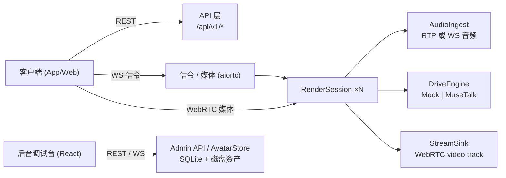

# 数字人服务 (Digital Human Service)

商用实时交互数字人服务：接收**音频 + 形象 ID**，输出**实时数字人视频流**（WebRTC）。
附带 React 后台管理台（形象管理 / 会话调试 / 数字人对话 / 系统监控）。

支持**两种并存**的数字人形态，由 `avatars.kind` 区分：

| 形态 | 渲染位置 | 驱动方式 |
|---|---|---|
| `photoreal` | 服务端（GPU） | MuseTalk / LivePortrait / Wan 2.2，WebRTC 视频流 |
| `live2d` | 客户端（WebGL） | Cubism SDK；服务端只托管模型文件，**不产出任何像素** |

Live2D 的口型在客户端由**正在播放的那个 AudioBuffer** 离线预算出的包络驱动，因此嘴与声音
天然零漂移。管理台的三个页面都能选择 Live2D 形象；另有 Electron 桌面宠物（透明置顶窗口）。

生产路径是**真实 MuseTalk 1.5**：上传一张照片，服务端跑人脸检测 → 对齐裁剪 → 解析遮罩 →
VAE 编码，产出一份形象包；会话中每个 100ms 音频块驱动一次 UNet，解出下半脸再融合回原图。
这是 MuseTalk 的固有形态 —— 它是「视频配音」模型，单张照片时头部静止、只有嘴与下颌区域动。
若日后要头部摆动，那是 LivePortrait 一类模型的活，不在当前范围内。

`mock` 引擎与 `mock` 制作流水线**保留为测试替身**：无 GPU 的机器与 CI 用它跑通全链路。
生产部署请按下面的「MuseTalk 环境准备」启用真实路径。

技术栈：Python 3.11+ / FastAPI / aiortc / SQLAlchemy + SQLite；React + Vite + TS + vitest。

## 关于鉴权（重要）

多租户与 API Key 鉴权已在一次重构中删除，**当前所有端点均无鉴权**：
`/api/v1/*` 与 `/api/admin/*` 全部公开，假设部署在单机操作者控制的机器上。
本 README 早期版本描述的 `X-API-Key` / `X-Admin-Token` 已不存在，相关代码已删除。

新增的 Live2D 模型托管端点例外：它们接受可选的 `X-V1-Token`（见 `DH_V1_API_TOKEN`）。
该令牌默认留空（不校验），供桌面宠物连接远程部署时使用。**给整个管理面补鉴权是另一件
独立的事**，本项目未处理。

## 架构



- **API 层**：形象 CRUD、会话生命周期、API Key 鉴权（`/api/v1/*`）。
- **SessionManager / RenderSession**：会话编排与状态机（`idle → listening → speaking → closed`）。
  空闲时按帧率推静态保活帧，避免视频轨因无帧可发而冻住。
- **DriveEngine**：口型驱动抽象，`drive(avatar_pack, audio_chunk) -> frames`；实现 `mock` / `musetalk`。
  真引擎把同步 CUDA 工作放到单工作线程池，事件循环不被阻塞；跨会话在 GPU 上串行。
- **AvatarPipeline**：上传照片/视频 → 形象包的抽象；实现 `mock`（占位产物）/ `musetalk`（真实制作）。
- **AvatarStore**：形象包管理（SQLite 元数据 + 磁盘资产）。
- **音频双通道**：RTP audio track 为主，WS 音频分片为备，进入同一 `AudioIngest`，引擎无感知。
- **会话短生命周期**：显式 DELETE 或 `DH_SESSION_IDLE_TIMEOUT` 秒无音频自动回收。

## 快速开始

前置：Python 3.11+、Node 18+。真实模型另需 NVIDIA GPU（见下节）。

```bash
# 1. Python 虚拟环境与依赖（torch-free，够跑 mock 与全部单测）
python -m venv .venv
source .venv/Scripts/activate          # Windows (Git Bash)；PowerShell 用 .venv\Scripts\Activate.ps1
pip install -e ".[dev]"

# 2. 构建后台调试台（构建产物由 FastAPI 挂载到 /admin）
cd admin-ui
npm install
npm run build
cd ..

# 3. 配置环境变量
cp .env.example .env                    # 按需修改 DH_LIVE2D_SDK_DIR / DH_V1_API_TOKEN

# 4. 启动服务（mock：无 GPU 也能跑通全链路）
python -m uvicorn --factory server.main:create_app --host 0.0.0.0 --port 8000
```

要在本机跑真实模型，先按「[MuseTalk 环境准备](#musetalk-环境准备)」建好 `.venv-musetalk`
并拉取权重，然后用那个解释器启动：

```bash
DH_DRIVE_ENGINE=musetalk DH_AVATAR_PIPELINE=musetalk \
  ./.venv-musetalk/Scripts/python.exe -m uvicorn --factory server.main:create_app \
  --host 0.0.0.0 --port 8000
```

打开 <http://127.0.0.1:8000/admin> 进入管理台（无登录步骤，见「关于鉴权」）。

> **必须使用 `--factory` 形式**：`server/main.py` 只暴露 `create_app()` 工厂，没有模块级 `app`，
> 因此 `uvicorn server.main:app` 会失败。`uvicorn --factory server.main:create_app` 等价可用。

健康检查：

```bash
curl http://127.0.0.1:8000/healthz
# {"status":"ok","engine":"mock","pipeline":"mock","gpu":false}
```

`gpu` 在启动时探测一次（导入 torch 是昂贵的那一步，而结论不会在运行中改变）。
`engine` 与 `pipeline` 是配置里选定的实现名，不是探测结果 —— 见「环境变量」。

开发时前端可 `cd admin-ui && npm run dev`（Vite 已把 `/api` 代理到 `127.0.0.1:8000`）。

## 环境变量

所有配置经 `DH_` 前缀读取，也可写入 `.env`（`.env` 已 gitignore，**切勿提交**）。

| 变量 | 默认值 | 说明 |
|---|---|---|
| `DH_DRIVE_ENGINE` | `musetalk` | 驱动引擎：`mock` 或 `musetalk` |
| `DH_AVATAR_PIPELINE` | `musetalk` | 形象制作流水线：`mock` 或 `musetalk`。与 `DH_DRIVE_ENGINE` 保持一致：mock 形象包没有真引擎要读的 sidecar，真形象包带着 mock 用不上的张量 |
| `DH_AVATAR_MAX_VIDEO_SECONDS` | `15.0` | 驱动视频时长上限（秒），超出上传即 422 |
| `DH_AVATAR_MAX_VIDEO_FRAMES` | `375` | 驱动视频解码帧数上限（15s × 25fps） |
| `DH_AVATAR_CACHE_SIZE` | `2` | 引擎按形象缓存的份数；视频形象每份常驻约 1GB 内存 |
| `DH_AVATAR_MAX_UPLOAD_BYTES` | `300000000` | 上传字节上限，超出返回 413 |
| `DH_DATA_DIR` | `data` | 运行时数据目录（SQLite、形象资产、模型权重） |
| `DH_DATABASE_URL` | `sqlite:///data/digital-human.db` | SQLAlchemy 数据库 URL |
| `DH_ADMIN_PASSWORD` | `admin123` | **已失效** —— 登录鉴权随多租户重构一并删除，保留仅为不打断旧 `.env` |
| `DH_ADMIN_TOKEN` | `dev-admin-token` | **已失效** —— 同上，无任何端点校验它 |
| `DH_V1_API_TOKEN` | 空 | Live2D 模型托管端点的可选令牌（请求头 `X-V1-Token`）。留空 = 不校验，供桌面宠物连远程部署 |
| `DH_LIVE2D_ENABLED` | `true` | 关掉后管理台不再提供 Live2D 相关入口 |
| `DH_LIVE2D_SDK_DIR` | `data/CubismSdkForWeb-5-r.5` | Cubism SDK 所在目录。服务端**只**从这里读 `Core/` 与 `Shaders/` 用于下发给浏览器，不渲染任何 Live2D |
| `DH_SESSION_IDLE_TIMEOUT` | `60` | 会话无音频自动回收秒数 |
| `DH_SESSION_SWEEP_INTERVAL` | `10` | 空闲回收扫描周期（秒） |
| `DH_FRAME_WIDTH` | `720` | 输出视频宽 |
| `DH_FRAME_HEIGHT` | `1280` | 输出视频高 |
| `DH_FPS` | `25` | 输出帧率 |
| `DH_SAMPLE_RATE` | `48000` | 音频采样率（Hz） |
| `DH_MINIMAX_API_KEY` | 空 | MiniMax TTS 密钥。留空即禁用调试页的文本合成，端点返回 503 |
| `DH_MINIMAX_GROUP_ID` | 空 | 可选：老账号需要它作为 `GroupId` query 参数，新账号只认 bearer token |
| `DH_MINIMAX_BASE_URL` | `https://api.minimaxi.com` | 国内平台；国际版改 `https://api.minimax.io` |
| `DH_MINIMAX_MODEL` | `speech-02-hd` | 合成模型 |
| `DH_MINIMAX_SAMPLE_RATE` | `32000` | 合成采样率。MiniMax 上限 44100，故**不可能是** `DH_SAMPLE_RATE`，重采样在浏览器侧完成 |

> **LLM 配置不走环境变量**。OpenAI 兼容大模型的 `api_key` / `base_url` / `model`
> 在 Models 页面的「服务」列表中点击大模型行的 **[设置]** 写入 SQLite `settings`
> 表；`.env` 里没有对应变量。这样能让一次部署的服务在 UI 上切换 provider，
> 也避免泄漏的 `DH_LLM_*` 在没显式 opt-in 时打开 chat 端点。

> 上表是**代码默认值**。`.env.example` 模板里两个引擎项都写成 `mock`，这样
> `cp .env.example .env` 之后在 torch-free 的 `.venv` 里能直接跑通 —— 若模板发
> `musetalk`，一次形象上传就会去 import torch 而失败。生产部署按「MuseTalk 环境准备」
> 把两者一起改成 `musetalk`。

## 对外 API

媒体参数：音频 48kHz / 16bit / 单声道 PCM；视频 25fps，720×1280，H.264（WebRTC video track）。

### 业务面 `/api/v1`（**无鉴权**）

| 方法 | 路径 | 说明 |
|---|---|---|
| POST | `/api/v1/avatars` | multipart `name` + `file` 上传照片或短视频（≤15s）创建形象，返回 `{avatar_id, status:"pending"}`，异步预处理。视频形象以动态驱动方式渲染：头部/身体沿用视频运动，嘴部由音频驱动；空闲时循环播放源视频画面，录制时请保持闭嘴、不说话 |
| GET | `/api/v1/avatars` | 形象列表。可选 `?kind=live2d` 只列 Live2D 形象 |
| GET | `/api/v1/live2d/avatars/{id}/model/{path}` | 模型目录内的单个文件。`DH_V1_API_TOKEN` 非空时需 `X-V1-Token` |
| GET | `/api/v1/live2d/runtime/{path}` | Cubism SDK 的 `Core/` 与 `Shaders/`。**不鉴权**：core 经 `<script>` 标签加载（无法带请求头），shader 由 framework 自行 fetch（同样无法配置请求头）。路径限定在这两个子树内 |
| GET | `/api/v1/avatars/{avatar_id}` | 形象详情（`status` 供轮询制作完成：`pending`/`processing`/`ready`/`failed`） |
| DELETE | `/api/v1/avatars/{avatar_id}` | 删除形象及资产（204） |
| POST | `/api/v1/sessions` | JSON `{"avatar_id"}` 创建会话，返回 `{session_id, status, signal_url, audio_url}`（形象须为 `ready`） |
| GET | `/api/v1/sessions` | 会话列表 |
| GET | `/api/v1/sessions/{session_id}` | 会话详情（含实时 `metrics`，见下） |
| DELETE | `/api/v1/sessions/{session_id}` | 结束会话并落库最终指标（204） |
| WS | `/api/v1/ws/signal/{session_id}?api_key=` | WebRTC 信令（SDP offer/answer、ICE） |
| WS | `/api/v1/ws/audio/{session_id}?api_key=` | 备用驱动通道：二进制帧为 s16le 单声道 48kHz PCM；文本帧 `{"type":"flush"}` 排空残留分块 |

> 健康检查 `GET /healthz`（无需鉴权）。

#### 会话指标 `metrics`

| 字段 | 含义 |
|---|---|
| `frames_out` | 被音频**驱动**产生的帧数 |
| `keepalive_frames` | 空闲保活帧数。与 `frames_out` 分开计：它没有驱动任何东西，混进去会让一个长期空转的会话看起来跑得更好 |
| `dropped_frames` | 下游 sink 已关闭后仍尝试推送的帧数 |
| `fps` | 名义帧率（配置值，非实测） |
| `avg_latency_ms` | 每块延迟的 EMA（0.8 旧 + 0.2 新） |
| `blocks` | 累计处理的音频块数（每块 100ms） |
| `state` | `idle` / `listening` / `speaking` / `closed` / `error` |
| `queue_depth` | 引擎工作队列中待处理的作业数（`mock` 恒为 0，它同步渲染） |
| `overflows` | WebRTC 视频轨因队列满而丢弃的帧数。持续 > 0 表示渲染跟不上推流 |
| `p50_latency_ms` / `p95_latency_ms` / `max_latency_ms` | 最近 600 块（60 秒）延迟分位数，无样本时为 `0.0` |
| `latency_histogram` | 同一窗口的延迟分桶（`<25` … `>=250` ms），零桶省略 |

**块延迟是唯一值得盯的实时性指标**：一个块承载 100ms 音频，所以延迟长期超过 100ms 就意味着
音频入流速度超过渲染速度、A/V 延迟无界增长。此时先看 `overflows` 与 `queue_depth` 是否同步上升。

#### 调试页文本驱动（MiniMax TTS）

调试页除了麦克风与上传音频文件，还可以**只输入文本**：页面向 `POST /api/admin/tts`
要一段合成音频，拿到后走与上传文件**完全相同**的那条通道（`sendAudioBlob` →
`decodeAudioData` → 重采样到 48k → WS 音频分片）。

链路里有两处值得知道：

- **采样率对不上是常态。** MiniMax 最高只到 44100 Hz，而渲染会话固定吃 48000 Hz。
  所以服务端只把 hex 音频套上 WAV 头原样返回，**重采样放在浏览器**——复用上传路径里
  已经测过的那段代码，服务端因此不需要任何音频编解码依赖。
- **WebRTC 只回传视频轨，没有音频。** 调试页会另外用 `<audio>` 本地回放同一段合成音频，
  否则你只能看见嘴动、听不见声音。

需要 `DH_MINIMAX_API_KEY`；未配置时按钮会报出服务端那句 503 的说明。

### 管理面 `/api/admin`（**无鉴权**）

| 方法 | 路径 | 说明 |
|---|---|---|
| POST | `/api/admin/login` | JSON `{"password"}` → `{"token"}`。**已失效**，登录鉴权随多租户重构删除，保留仅为不打断旧调用 |
| POST | `/api/admin/live2d/avatars` | JSON `{name, model_dir, config}` → 复制并校验 Cubism 工程后建 `kind=live2d` 行。校验失败 422，消息指出具体缺失文件 |
| DELETE | `/api/admin/live2d/avatars/{id}` | 删除 Live2D 形象及其模型文件（204）。对 `photoreal` 形象返回 404 |
| GET | `/api/admin/live2d/health` | SDK 是否就绪。**从不抛错** —— SDK 缺失是要在系统页展示的状态，不是异常 |
| GET | `/api/admin/system` | 引擎描述 / 制作流水线名 / GPU / 版本 / 数据目录 |
| GET | `/api/admin/tenants` | 租户列表 |
| POST | `/api/admin/tenants` | JSON `{"name"}` → `{tenant_id, name, api_key}`（`api_key` 仅此一次返回） |
| POST | `/api/admin/tenants/{tenant_id}/api-key` | 轮换并返回新 API Key（旧 key 立即失效） |
| GET | `/api/admin/avatars` | 形象列表（可选 `?tenant_id=` 过滤） |
| POST | `/api/admin/avatars` | multipart `name` + `file`（可选 `tenant_id`）创建形象 |
| GET | `/api/admin/avatars/{avatar_id}` | 形象详情 |
| DELETE | `/api/admin/avatars/{avatar_id}` | 删除形象（204） |
| POST | `/api/admin/avatars/{avatar_id}/retry` | 重试制作（202） |
| PATCH | `/api/admin/avatars/{avatar_id}/config` | 调优 `mouth_scale` / `expression_intensity` |
| GET | `/api/admin/avatars/{avatar_id}/idle.mp4` | 空闲循环视频（视频形象；首次请求时生成，支持 Range） |
| GET | `/api/admin/avatars/{avatar_id}/normalized.png` | 静态画面（照片形象与回退） |
| POST | `/api/admin/tts` | JSON `{"text", "voice_id"}` → `audio/wav`。调试页用；`text` 为空 400，`voice_id` 缺失 400，未配 `DH_MINIMAX_API_KEY` 503，MiniMax 报错 502 |
| GET | `/api/admin/llm/config` | 大模型（OpenAI 兼容）配置；返回 `api_key_masked` 与 `configured` 标志 |
| PUT | `/api/admin/llm/config` | 同上，写入到 `settings` 表 |
| POST | `/api/admin/llm/chat` | JSON `{messages}` → `{content}`。非流式；用作同步回退 |
| POST | `/api/admin/llm/chat/stream` | JSON `{messages}` → `text/event-stream`。每帧 `{"delta": "..."}` / `{"done": true}` / `{"error": ...}`。调试页大模型对话的入口 |
| GET | `/api/admin/jobs` | 制作任务（AvatarJob）列表 |
| GET | `/api/admin/sessions` | 会话列表（含实时指标） |
| POST | `/api/admin/sessions/sweep` | 手动触发空闲会话回收 |

## MuseTalk 环境准备

真实路径需要一个独立解释器，理由有三：本项目的 `.venv` 是 Python 3.14，而 PyPI 上没有
cp314 的 torch 轮子；把 torch 挡在 `.venv` 之外，默认 `pytest` 才能保持 torch-free 且十秒内跑完；
两套环境的体积也差一个数量级（带权重约 6 GB vs 几十 MB）。

### 一条命令

```bash
bash scripts/setup_musetalk.sh
```

脚本做五件事，每一步都幂等，重跑只补缺失的部分：

1. `uv venv --python 3.11 .venv-musetalk`（本机没有 3.11 时 uv 自己下载）
2. 从 **cu128** 索引装 `torch` + `torchvision`
3. `uv pip install -e ".[musetalk,dev]"` —— **不是** MuseTalk 自己的 `requirements.txt`
4. `git clone` MuseTalk 到 `vendor/MuseTalk` 并 `checkout` 到钉死的 commit
5. 拉取权重到 `data/models/musetalk/`

跳过 4.4 GB 权重下载：`bash scripts/setup_musetalk.sh --no-weights`。

第 4 步按 `github.com` → `ghproxy.net` → `gh-proxy.com` → `ghfast.top` 的顺序重试。本网络上
github.com 会解析、也会回 curl，但 git 的 HTTPS 连接会被重置，因此必须有这个回退；三个代理都
服务同一个仓库与同一个 commit（`0a89dec4`），当前也正是上游默认分支的 HEAD。

### 为什么是 cu128，为什么不是上游的 requirements.txt

**torch 必须走 cu128 索引。** cu126 及更早的轮子不含 sm_120 kernel；在 RTX 50 系上它能装能 import、
也能报告设备，但第一次 kernel launch 就报 `no kernel image is available for execution`。
`scripts/setup_musetalk.sh` 末尾的校验就是跑一次 1024² 矩阵乘来堵这个坑。

**不装上游 `requirements.txt`。** 那个文件把 `numpy` 钉在 1.23.5，还拖进 `tensorflow==2.12.0`、
`gradio`、`tensorboard` 与 SyncNet 权重 —— 全是训练与演示脚本用的，推理路径一个都不 import，
而那几个钉版正是它在 cp311+ 上解析失败的原因。实际需要的运行时子集声明在 `pyproject.toml`
的 `[project.optional-dependencies] musetalk` 里。

### 用 mediapipe 顶掉 DWPose

MuseTalk 用 DWPose 出人脸框与关键点，而 DWPose 要 OpenMMLab 全家桶（mmcv/mmdet/mmpose/mmengine），
其中 mmcv 需要 MSVC 源码编译。但我们的输入是**单张静止照片** —— 不需要视频逐帧的全身姿态跟踪，
只需要从一张图里取一组框和关键点。`server/avatar/musetalk_pipeline.py` 因此改用 pip 可装的
mediapipe FaceLandmarker，把整条最难的依赖链删掉。人脸解析（mask）仍用 MuseTalk 自带的
face-parse-bisent，那是纯 PyTorch。

### 权重清单

`data/models/musetalk/` 下必须齐备（缺失即抛 `PipelineError` / `EngineUnavailable`，
并在消息里点出缺了哪些）：

```
data/models/musetalk/
├─ face_landmarker.task              # mediapipe，3.6 MB（替代 DWPose）
├─ face-parse-bisent/
│  ├─ 79999_iter.pth                 # biSeNet 人脸解析
│  └─ resnet18-5c106cde.pth          # 它的 backbone，来自 download.pytorch.org
├─ musetalkV15/
│  ├─ unet.pth                       # MuseTalk 1.5 UNet，3.17 GB
│  └─ musetalk.json
├─ sd-vae/                           # stabilityai/sd-vae-ft-mse
│  ├─ config.json
│  └─ diffusion_pytorch_model.bin
└─ whisper/                          # openai/whisper-tiny（音频编码器）
   ├─ config.json
   ├─ pytorch_model.bin
   ├─ preprocessor_config.json
   └─ …（tokenizer / vocab / merges 等）
```

权重来源与网络：**huggingface.co 在本网络不可达**，`scripts/fetch_musetalk_weights.sh` 因此走
**ModelScope**（`modelscope.cn/api/v1/models`，可达且快）；mediapipe 的 `.task` 与 resnet18 来自
Google / PyTorch 官方 CDN。若换到能直连 HF 的网络，可改用 `HF_ENDPOINT=https://hf-mirror.com`。
`vendor/` 与 `data/` 都已 gitignore，权重不入库。

### GPU 要求

| 项 | 要求 |
|---|---|
| 显存 | 单会话约 4.5 GB，双会话实测约 6 GB；建议 ≥ 8 GB，16 GB 充裕 |
| 算力 | 需 sm_75 以上；RTX 50 系（sm_120）**必须** cu128 轮子 |
| 实测 | RTX 5070 Ti 16GB：单会话 ~31 fps，双会话并发各 ~21 fps，p95 块延迟 ~87 ms |

渲染的瓶颈是 VAE 解码（约占双会话渲染时间的 58%），已确认是算力下限而非 launch 开销 ——
批处理、分块、`channels_last`、`torch.compile`、CUDA graph 都试过，没有收益。

### 启动

```bash
python -m uvicorn --factory server.main:create_app  --host 0.0.0.0 --port 8000

```

启动时后台任务会预热权重（4.4 GB），避免第一个 `POST /sessions` 付这笔代价；预热失败不致命，
服务照常起来，只是真引擎不可用。

 ## 目录结构


```
digital-human/
├─ server/                  # Python 包
│  ├─ main.py               # FastAPI app 工厂 create_app()
│  ├─ config.py             # DH_* 配置
│  ├─ api/                  # REST + WS：avatars, sessions, admin, deps
│  ├─ core/                 # session_manager, render_session, audio_ingest, stream_sink, webrtc
│  ├─ engine/               # base(接口), mock_engine(测试替身), musetalk_engine(生产)
│  ├─ avatar/               # store, pipeline, musetalk_pipeline
│  └─ db/                   # models, session
├─ admin-ui/                # React + Vite 调试台（构建产物挂载到 /admin）
├─ scripts/
│  ├─ setup_musetalk.sh     # 一条命令复现真实环境
│  └─ fetch_musetalk_weights.sh
├─ vendor/MuseTalk/         # 上游源码，clone 到钉死的 commit（gitignore）
├─ data/                    # 运行时资产与模型权重（gitignore）
├─ tests/
└─ pyproject.toml
```

## 测试

默认套件跑在 `.venv`（Python 3.14，无 torch），十秒内完成：

```bash
python -m pytest -q                     # 全量单测 + 集成（含 tests/test_e2e_smoke.py 全链路）
cd admin-ui && npm run build            # 前端类型检查 + 构建
```

`gpu` 与 `musetalk` 两个 marker 默认被 `addopts` 排除。需要真设备与真权重的测试跑在
`.venv-musetalk`：

```bash
./.venv-musetalk/Scripts/python.exe -m pytest -q -m 'gpu or musetalk'
```

`tests/conftest.py` 同时把 `DH_DRIVE_ENGINE` 与 `DH_AVATAR_PIPELINE` 钉成 `mock` ——
否则所有走上传路径的测试（`test_e2e_smoke` / `test_sessions_api` / `test_ws_audio` /
`test_signal_ws` / `test_admin_api`）会去加载真权重。带 torch 的文件另有
`pytest.importorskip("torch")` 兜底，在错误的解释器里会干净地 skip 而不是报错。

## 错误处理

统一错误信封：`{"error": {"code", "message", "detail"}}`。形象制作失败置 `status=failed` 并落库 error，
支持重试；引擎运行时异常令会话置错并推 WS 事件，不拖垮进程；会话空闲自动回收防资源泄漏。

上传环节错误码：`invalid_video`（视频无法解码，422）、`video_too_long`（时长或帧数超限，422）、`file_too_large`（413）、`idle_video_unavailable`（空闲视频生成失败，503）。
